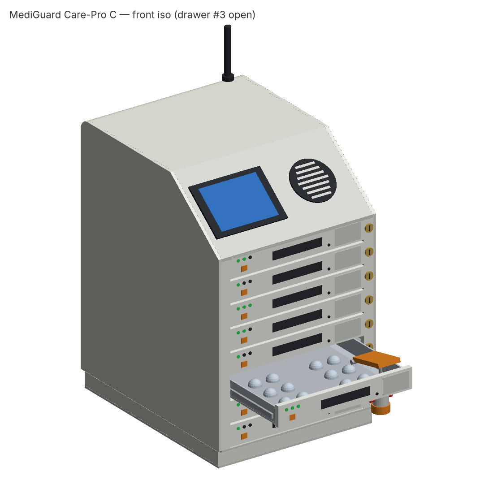
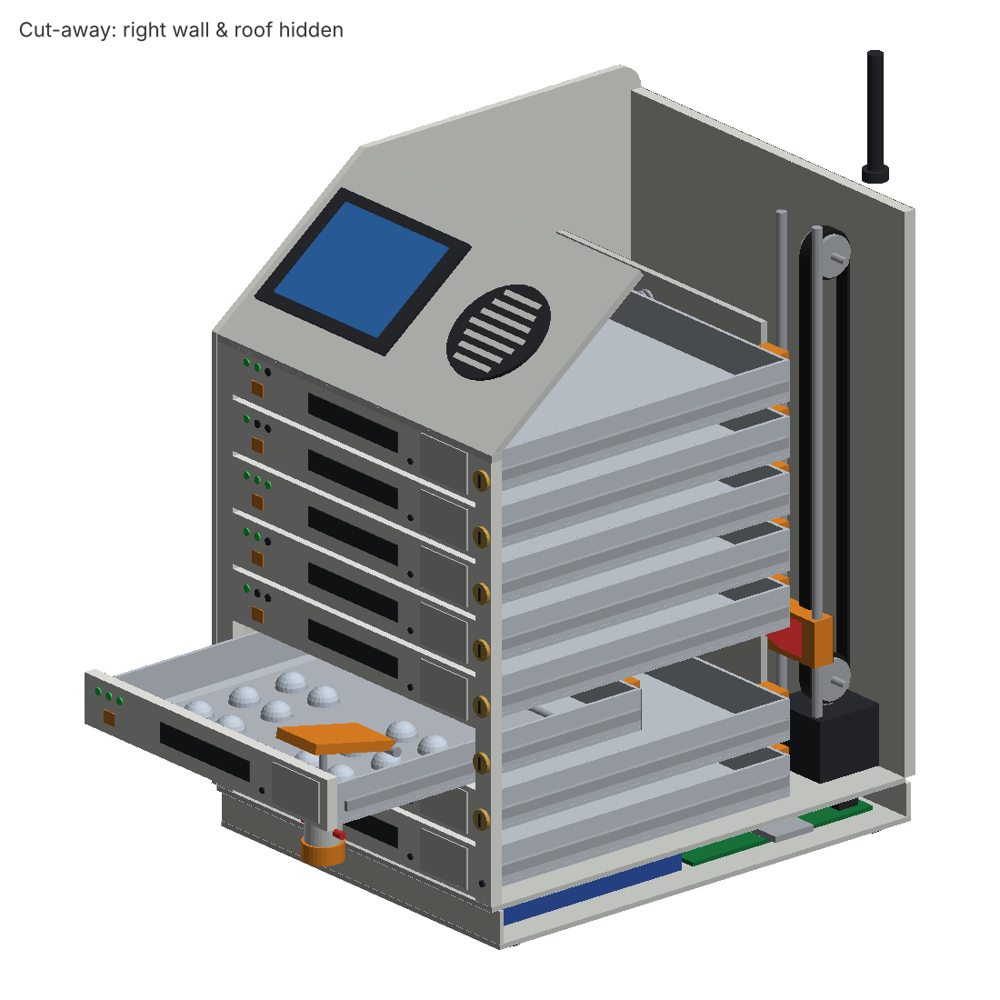

# MediGuard Care-Pro — Concept C

3D model of an 8-drawer smart pill dispenser (160 × 200 × 250 mm), built from the Concept C sketches.

**Live 3D viewer:** open `index.html` through GitHub Pages (link in the repo's About section) — rotate, cut away the right wall, and click any part to see its name.

## Files
| File | What it is |
|---|---|
| `index.html` | Interactive 3D viewer (opens in any browser) |
| `MediGuard_CarePro_C.FCMacro` | FreeCAD macro — builds the full coloured, editable model and saves `.FCStd` + `.step` |
| `MediGuard_CarePro_C.stl` | Mesh for 3D printing / quick viewing (no colours) |
| `previews/` | Rendered images |
| `source/` | Python geometry definition and build scripts |

## Open in FreeCAD
Macro → Macros… → select `MediGuard_CarePro_C.FCMacro` → Execute.

## Key dimensions (mm)
Body 160 W × 200 D × 250 H · base Z 0–20 · 8 drawers on 22 mm pitch (Z 20–196) · 136 × 20 drawer fronts · 54 mm header with ~37.6° slant over 70 mm · 2.8" display (72 × 52) · Ø42 speaker · Ø16 pulleys at 165 mm centres · 270 mm open depth.
